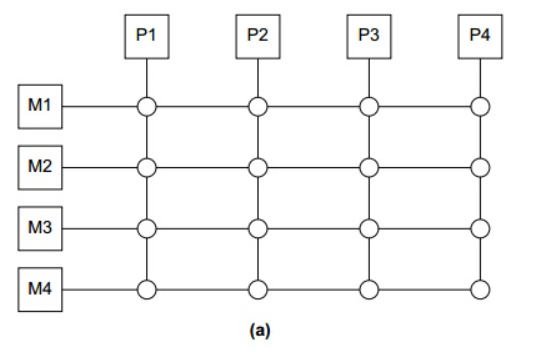
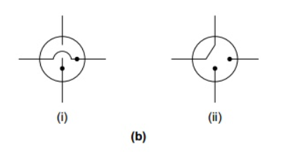
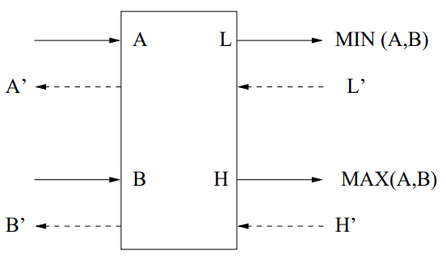
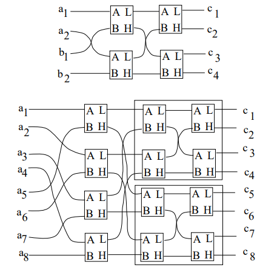

# Historical Context and Motivation

In the 1960s, the United States saw rapid growth in the number of computers installed. General-purpose computer installations in the United States increased from approximately 6,000 in 1960 to over 67,000 by the end of 1968 (U.S. Congress, Joint Economic Committee, 1970, p. 165). To achieve higher throughput, computers increasingly began performing several operations simultaneously. This included performing I/O operations independently of computation, as well as using multiprocessor systems in which multiple processors could work concurrently. One example was the Burroughs D825 (1962), a modular multiprocessor system whose first installation was delivered to the U.S. Navy in July 1962. Its fully expanded configuration included four processor modules, 16 memory modules, 10 I/O control modules, and up to 64 peripheral devices. The processor modules shared access to one another, to all memory, and to I/O. By April 1964, 37 systems for other government agencies were in use or on order (Anderson, 1964, p. 30). However, this growth gave rise to a major problem in the design of such computing systems: interconnecting their various components, such as I/O devices, memories, and processing units, so that all required data transfers could be performed efficiently and reliably. There were two common approaches to this problem at the time  K. E. BATCHER published his paper: *high speed buses* and *cross-bar switches or matrices*. A bus is a communication channel connecting different parts of the computer. Such buses were time-shared, which meant each component could communicate through the bus only one at a time. The biggest problem with high speed buses was that they were limited by the speed of the available hardware. A crossbar switch or matrix is a switching structure which connects multiple inputs to multiple outputs(such as memory units to processors) using a grid of connections called cross-points.

*Figure 1: Crossbar switch architecture. Source: BrainKart (2017).*

 

*Figure 2: Switch architecture. Source: BrainKart (2017).*

The limitations of this scheme are firstly, the amount of hardware(an n by m matrix requires n x m cross-points) and secondly, the "fan-in, fan-out" of the hardware, which means the number of inputs a component can receive(fan-in) and the number of other hardware  elements the component can send an output to(fan-out). To provide an alternative solution, K. E. Batcher published his paper "Sorting Networks and Their Applications" on 30 April 1968 describing networks that have a fast sorting or ordering capability. Such networks could sort $2^p$ words in `1/2 * p(p+1)` steps and could be used as a multiple-input, multiple-output switching network. They have the advantages over a normal crossbar of both requiring less hardware(an n-input n-output switching network could be built with approximately `1/4*n((log(n)^2)` elements as opposed to $n^2$ in a normal crossbar) and having a constant fan-in, fan-out requirement on their elements. These networks allow thousands input and output lines to be integrated with a reasonable amount of hardware. They address the problem because they can be used as switching networks(networks which establish communication paths between input and output lines).

## Sorting Networks as Switching Networks

Consider a system with multiple input and output lines, where each output line is assigned a numerical address. To communicate with the output lines, the input lines send data along with the numerical address of the output that should receive it. The network then sorts the address-data pairs based on the input addresses and sends the corresponding data to the correct output lines.

For instance, consider a network where the numerical addresses of the output lines are [1, 2, 3, 4, 5], and the input addresses are [3, 1, 2, 5, 4], each associated with a data input. The network sorts the input addresses (along with their corresponding data) into the order [1, 2, 3, 4, 5], ensuring that each data input is sent to its corresponding output line.

However, this approach assumes that each input line sends data to a unique output line, which is normally not the case, as an output line may receive requests from several input lines. This is known as the **conflict-resolution problem**.

### Conflict Resolution

To resolve this issue, we modify the aforementioned system in a few ways.

Firstly, instead of sending the actual data immediately, each active input now sends a request containing the desired output address, a control bit set to 1, and a priority number. The sorting network groups the inputs with the same address and orders them according to their priority number.

Secondly, each output line contains an additional item, an **output marker**, which identifies the corresponding output line. Like an input request, it includes the output line address, but contains no data and has a control bit of 0, which distinguishes it from real input requests. We then merge these markers with the already sorted input requests into a single list. Since the items are ordered by address, each output marker is placed immediately after all input requests directed to its corresponding output.

Thirdly, we introduce a new component, the **adjacent-word transfer network**, which examines the resulting list. This component looks at each output marker and checks the item immediately above it. If the control bit is 1, this means that it is a real input request, and a connection is established with the corresponding output line. Otherwise (if the control bit is 0), no connection is established. Since the input requests are also ordered according to their priority numbers, the input with the lowest priority number is selected in each case.

Finally, the adjacent-word transfer network sends signals back along the established communication paths. These signals notify the input and output lines whether their connection was successfully established. Once this process is complete, the actual data can be transmitted through the established connections.

### Other Applications

On top of this, there were other applications for these networks, such as implementing a multi-access memory, a multi-access content-addressable memory, and a multiprocessor. Of course, they may also simply be used for sorting and merging.

## Comparison Elements and Bitonic Sorters

A fundamental building block of these networks are comparison elements, which are components that receive two numbers A and B and present their minimum on their L output and their maximum on the H output.  comparison elements can also be bi-directional, which allows the information to also travel in the opposite direction,

*Figure 2: Symbol for a comparison element. Source: BrainKart (2017).*

Using these components, Batcher provides two methods of constructing a sorting/merging network, "odd-even merging networks" and "bitonic sorters". We will focus on explaining bitonic sorters as well as how they can be extended to build a complete bitonic sort algorithm, we will implement the algorithm and perform an  analysis on it.

### Bitonic Sequences

A **sequence** is called bitonic if it is the result of the concatenation of two monotonic sequences, one ascending and one descending. (The definition also includes sequences which are purely monoticnially increasing or decreasing).

### Bitonic Merger

A **bitonic merger** is a procedure (or a hardware component that performs that procedure) that takes a bitonic sequence of length $x$ as input and transforms it into a fully sorted sequence using comparison elements. It does so by dividing the sequence into pairs whose positions differ by a distance $d$. where

$$
d = \frac{x}{2}, \frac{x}{4}, \ldots, 1
$$

At each stage, the elements within these pairs are compared using ascending or descending comparators, depending on the desired sorting order. For ascending order, two elements are swapped if the first is greater than the second; for descending order, they are swapped if the first is smaller than the second. The process is repeated with decreasing values of $d$ until $d = 1$, after which point the sequence is sorted.

*Figure 3: Construction of bitonic sorters for 4 and 8 numbers. Source: Batcher (1968, p. 307, Fig. 1).*

Please notice that large bitonic sorters can be constructed from a number of smaller bitonic sorters, this allows large networks to be built of standard modules of convenient size.

### Constructing a Sorter for Arbitrary Sequences

A sorter for arbitrary sequences can be constructed from bitonic sorters using the following scheme, commonly known as sorting by merging:

We split the sequences into pairs of two and sort the pairs using a comparator. We then reverse the second sequence and concatenate the two sequences to form bitonic sequences. Next, we apply the bitonic sorter to these sequences and concatenate them again (reversing the second sequence) to form bitonic sequences of greater length. This process repeats until the resulting sequence has the same length as the original one.

## Bitonic Sort Algorithm

We can now formulate the ascending Bitonic Sort algorithm (the descending version can be expressed in an analogous way).

Given an arbitrary sequence $A=[a_1,a_2,\ldots,a_n]$ of length $n$, for now, assume that $n=2^p$:

1. Divide the sequence into pairs of adjacent elements: $(a_1,a_2)$, $(a_3,a_4)$, ..., $(a_{n-1},a_n)$.
2. Apply the ascending comparator to each pair. Now we have $n/2$ pairs of elements in ascending order.
3. Take all the adjacent sorted sequences and combine them in pairs to form bitonic sequences. To do this, the first sequence is kept in ascending order, while the second sequence is reversed (placed in descending order).
4. Now we apply the bitonic merger to each bitonic sequence of length $x$ (in the first case, $x = 4$). Let $d$ be the distance between two elements $a_i$ and $a_{i+d}$, where:

   $$
   d = \frac{x}{2}, \frac{x}{4}, \ldots, 1
   $$

   At each stage, we divide the sequence into disjoint pairs whose positions differ by $d$, compare each pair and swap elements that are not in ascending order. This process is repeated for decreasing values of $d$, until $d = 1$.
5. This process is repeated for every pair of adjacent sorted sequences of the same length (in the first case, producing sorted sequences of length 4).

   At each subsequent iteration, the length of the sequences being combined doubles. Therefore, $x$ takes the values $4,8,16,\ldots,n$.
6. Repeat steps 3–5 until we get an array of length $n$; the array is sorted.

## Extension to Arbitrary Input Lengths

The original construction in Batcher's paper describes bitonic sorting networks containing $2^p$ inputs, where $p$ is a positive integer. To apply this algorithm to an array $A$ of arbitrary length $n$, we can define a new array $A'$ of length $m$, where

$$
m=2^{\lceil\log_2 n\rceil}.
$$

We fill the positions of $A'$ up to $n$ with the input elements and fill the remaining positions with a dummy variable (such as $+\infty$ or $-\infty$, as long as we know the positions of all dummy variables after applying the algorithm). In our case, we choose $+\infty$ (in C++, this can be expressed as `INT_MAX`).

For example:

$$
A=[7,2,5,8,1,6],\qquad N=6,\qquad M=8
$$

$$
A'=[7,2,5,8,1,6,+\infty,+\infty]
$$

## Worked Example

Let us go through an example:

$$
A=[7,2,5,8,1,6,3,4]
$$

1. We split $A$ into pairs: $(7,2)$, $(5,8)$, $(1,6)$, $(3,4)$.
2. We apply the ascending comparator: $(2,7)$, $(5,8)$, $(1,6)$, $(3,4)$.
3. We merge $(2,7)$ and $(5,8)$ into a bitonic sequence: $[2,7,8,5]$.
4. Compare at $d=2$ and swap if the elements are not in ascending order: $(2,8)\rightarrow(2,8)$, $(7,5)\rightarrow(5,7)$. Hence, we get $[2,5,8,7]$.
5. Compare at $d=1$ and swap if the elements are not in ascending order: $(2,5)\rightarrow(2,5)$, $(8,7)\rightarrow(7,8)$. Hence, we get $[2,5,7,8]$.
6. Repeating steps 3 and 4 for $(1,6)$ and $(3,4)$, we get $[1,3,6,4]$.
7. We now merge $[1,3,4,6]$ and $[2,5,7,8]$ into a bitonic sequence: $[1,3,4,6,8,7,5,2]$.
8. Compare at $d=4$ and swap if the elements are not in ascending order: $(1,8)\rightarrow(1,8)$, $(3,7)\rightarrow(3,7)$, $(4,5)\rightarrow(4,5)$, $(6,2)\rightarrow(2,6)$. Hence, we get $[1,3,4,2,8,7,5,6]$.
9. Compare at $d=2$ and swap if the elements are not in ascending order: $(1,4)\rightarrow(1,4)$, $(3,2)\rightarrow(2,3)$, $(8,5)\rightarrow(5,8)$, $(7,6)\rightarrow(6,7)$. Hence, we get $[1,2,4,3,5,6,8,7]$.
10. Repeating for $d=1$, we get $[1,2,3,4,5,6,7,8]$; the array is sorted.

If the size of $A$ had not been $2^p$, e.g. $A=[7,2,5,8,1,6,3]$, then we define $A'=[7,2,5,8,1,6,3,+\infty]$. We apply the algorithm to $A'$, and at the end we get $A'=[1,2,3,5,6,7,+\infty]$. We then remove the dummy variable to get $A=[1,2,3,5,6,7]$.

We then apply the algorithm to $A'$, and after that we can start removing the dummy variables, starting from the end of the array.

## Complexity Analysis

We will analyse the running time of the algorithm using the RAM model. Under this model, all elementary operations, such as arithmetic operations, comparisons and array indexing, take constant time.

We assume that we have an array of length $n$ that has been extended to an array of length $m$ using the dummy variable extension, where:

$$
m = 2^p, \qquad p = \lceil \log_2 n \rceil
$$

**Step 1.** Dividing the sequence into pairs using indexing (rather than creating new arrays) takes constant time for each pair(we only need to calculate the start and end index for each pair), we have m/2 pairs, hence the complexity is $\Theta(m)$.

**Step 2.** We compare $m/2$ pairs of elements and swap them if necessary. Let the cost of a comparison be $c_1$ and the cost of swapping be $c_2$.

In the worst case, we need to swap every pair, giving a cost of:

$$
\frac{m}{2}(c_1 + c_2)
$$

In the best case, no swaps are necessary, giving a cost of:

$$
\frac{m}{2}c_1
$$

Since both cases require at least $m/2$ comparisons, the complexity of this step is:

$$
\boxed{\Theta(m)}
$$

**Step 3.** We now combine adjacent sorted sequences into bitonic sequences. If we do not split the array into new arrays and instead use indexing to represent the different sequences, we do not need to physically concatenate them. We have $m/4$ pairs of sequences, and we need a swap for the second sequence of each pair, so the cost of this step is:

$$
\frac{m}{4}c_2
$$

and its complexity is:

$$
\boxed{\Theta(m)}
$$

After Step 3, we repeat the following operations at each subsequent iteration, which we call a *merging level*. A merging level consists of combining all adjacent pairs of sorted sequences of the same length and sorting the resulting bitonic sequences. At each merging level, the length of the resulting sorted sequences doubles:

1. Reverse the second sequence to construct a bitonic sequence.
2. Concatenate the two sequences (using indexing, so no physical copying is required).
3. Sort the resulting sequence by applying the bitonic merger.

Let $q = 2^k$ be the length of each of the two sorted subsequences being combined at a given merging level, where:

$$
1 \leq k \leq p-1
$$

At this level, we are combining two sequences of length $q$, producing a bitonic sequence of length $2q$. Therefore, we perform the following operations $m/(2q)$ times(as we are doing the operations on pairs of sequences each of length q).

**1. Reversing the second sequence**

Reversing a sequence of length $q$ requires $q/2$ swaps. Therefore, the total number of swaps at this level is:

$$
\frac{m}{2q} \cdot \frac{q}{2} = \frac{m}{4}
$$

Since each swap takes constant time $c_2$, the total cost is:

$$
\frac{m}{4}c_2
$$

Hence, the complexity of this operation at each merging level is:

$$
\boxed{\Theta(m)}
$$

**2. Concatenating the sequences**

As the splitting was done using indices, concatenation can be done in the same way. We simply need to calculate the indices for the result of the merge of two sequences, which takes constant time. There are $m/(2q)$ sequences, so this process takes $\Theta\left(\frac{m}{2q}\right)$ time.

**3. Applying the bitonic merger**

The bitonic merger takes a sequence of length $2q$ and compares pairs of elements at distances:

$$
d = q, \frac{q}{2}, \ldots, 1
$$

Since $q = 2^k$, the distance $d$ takes:

$$
\log_2(q) + 1 = k+1
$$

different values.

At each distance $d$, there are $q$ comparisons made (as we are comparing pairs of 2 out of a sequence of length $2q$). So the total number of comparisons for each pair being combined is:

$$
q \cdot (k+1)
$$

There are $m/(2q)$ pairs, so the total number of comparisons is:

$$
\frac{m}{2q} \cdot q \cdot (k+1) = \frac{m}{2}(k+1)
$$

Each comparison takes constant time $c_1$, and, in the worst case, each comparison may also require a swap of constant time $c_2$.

Thus, the cost of the bitonic merger is:

$$
\frac{m}{2}(k+1)(c_1+c_2)
$$

in the worst case and

$$
\frac{m}{2}(k+1)(c_1)
$$

in the best case, where no swaps are performed. both cases require at least m/2(k+1) operations, hence the complexity of this step is:

$$
\boxed{\Theta(m(k+1))}
$$

**Total cost at each merging level**

Combining the costs of reversing, concatenating and applying the bitonic merger, we obtain:

$$
W_k = \Theta(m) + \Theta(m) \Theta(m(k+1)) + \Theta\left(\frac{m}{2q}\right)
$$

Since $k \geq 1$, we have:

$$
\boxed{W_k = \Theta(m(k+1))}
$$

**Overall running time**

We now need to consider how many merging levels we perform. 
We consider $n=1$ as a special case. Since an array containing only one element is already sorted, no comparisons or merging operations are required. Therefore, $T(1)=\Theta(1)$. For the remainder of the analysis, we assume $n\geq2$. We start with sorted sequences of length $2$, and progressively combine them into sequences of lengths:

$$
4, 8, 16, \ldots, 2^p = m
$$

Therefore, $q$ takes the values:

$$
q = 2^1, 2^2, \ldots, 2^{p-1}
$$

and the corresponding values of $k$ range from $1$ to $p-1$.

The total running time, by combining the complexity from all the steps, is therefore:

$$
T(m) = \Theta(m) + \Theta(m) + \Theta(m) + \sum_{k=1}^{p-1}\Theta(m(k+1)) =\Theta(m) + \sum_{k=1}^{p-1}\Theta(m(k+1))
$$

Simplifying:

$$
T(m) = \Theta\left(m\left(1+\sum_{k=1}^{p-1}(k+1)\right)\right)
$$

Using the arithmetic series formula:

$$
T(m) = \Theta\left(m(1+2+3+\cdots+p)\right)
$$

Therefore:

$$
T(m) = \Theta\left(m\frac{p(p+1)}{2}\right) = \Theta(mp^2)
$$

Since:

$$
p=\lceil\log_2 n\rceil
$$

and:

$$
m=2^p
$$

we have:

$$
\boxed{n\leq m<2n}
$$

Furthermore, by the definition of the ceiling function:

$$
\boxed{\log_2 n\leq p<\log_2 n+1}
$$

Therefore, for $n\geq2$:

$$
n\leq m<2n
$$

and:

$$
(\log_2 n)^2\leq p^2<(\log_2 n+1)^2
$$

Combining these inequalities gives:

$$
n(\log_2 n)^2
\leq mp^2
<
2n(\log_2 n+1)^2
$$

Since, for $n\geq2$,

$$
\log_2 n+1\leq2\log_2 n
$$

we obtain:

$$
n(\log_2 n)^2
\leq mp^2
<
8n(\log_2 n)^2
$$

Thus, $mp^2$ is bounded both above and below by constant multiples of $n\log^2 n$. Consequently:

$$
\boxed{mp^2=\Theta(n\log^2 n)}
$$

As we have already shown:

$$
T(m)=\Theta(mp^2)
$$

so we finally obtain:

$$
\boxed{T(n)=\Theta(n\log^2 n)}
$$
The initial extension of the array using dummy elements requires at most $O(n)$ additional operations, so it does not change the final complexity.

## Parallel Execution

Using parallel execution hardware (assuming that we have a sufficient number of processing units to handle all independent operations), we can improve the running time of bitonic sort. We can perform independent operations, such as swaps and comparisons, simultaneously.

**Step 1.** All index calculations for the individual pairs can be performed simultaneously, requiring constant time.

**Step 2.** All comparisons and their corresponding swaps can be performed simultaneously, also requiring constant time.

At each subsequent merging level, we perform the following operations:

1. **Reversing:** Reversing only involves independent swapping operations. All swaps can be performed simultaneously, taking constant time.

2. **Concatenating:** All calculations for the indices of the resulting sequences can be performed simultaneously, taking constant time.

3. **Bitonic merger:** As established previously, the bitonic merger goes through $k+1$ different values of $d$. For each value of $d$, we perform $q$ comparisons within each group. Since there are $m/(2q)$ groups, the total number of comparisons at each value of $d$ is:

   $$
   \frac{m}{2q}\cdot q=\frac{m}{2}
   $$

   Each comparison is followed by a potential swap. Since the pairs are disjoint, all these compare-and-swap operations can be performed simultaneously, requiring constant time. However, the operations corresponding to different values of $d$ cannot be performed simultaneously, since each stage depends on the result of the previous one. Therefore, the bitonic merger requires:

   $$
   \Theta(k+1)
   $$

   parallel time.

Consequently, the total parallel time at each merging level is $\Theta(k+1)$.

Therefore, the total parallel running time is:

$$
T_{\text{parallel}}(m) = 4\Theta(1)+\sum_{k=1}^{p-1}\Theta(k+1)
$$

Using the arithmetic series formula:

$$
T_{\text{parallel}}(m) = \Theta(1+2+\cdots+p)
$$

Therefore:

$$
T_{\text{parallel}}(m) = \Theta\left(\frac{p(p+1)}{2}\right) = \Theta(p^2)
$$

Since:

$$
p=\lceil\log_2 n\rceil
$$

We have that the complexity of parallel execution is:

$$
\boxed{T_{\text{parallel}}(n)=\Theta(\log^2 n)}
$$

## References

Anderson, J.P. (1964) 'The Burroughs D825', *Datamation*, 10(4), pp. 30–34. Available at: https://www.bitsavers.org/magazines/Datamation/196404.pdf (Accessed: 17 November 2026).

Batcher, K.E. (1968) 'Sorting networks and their applications', in *Proceedings of the Spring Joint Computer Conference (AFIPS '68)*, 30 April–2 May 1968, pp. 307–314. Association for Computing Machinery. Available at: https://doi.org/10.1145/1468075.1468121 (Accessed: 17 November 2026).

BrainKart (2017) 'Parallel hardware'. Available at: https://www.brainkart.com/article/Parallel-Hardware_9324/ (Accessed: 17 November 2026).

United States Congress, Joint Economic Committee, Subcommittee on Economy in Government (1970) *Economy in government property management: Procurement of data processing equipment*. 91st Congress, 2nd Session, 1 July 1970. Washington, DC: U.S. Government Printing Office. Available at: https://www.govinfo.gov/content/pkg/CHRG-91jhrg49580/pdf/CHRG-91jhrg49580.pdf (Accessed: 17 November 2026).
